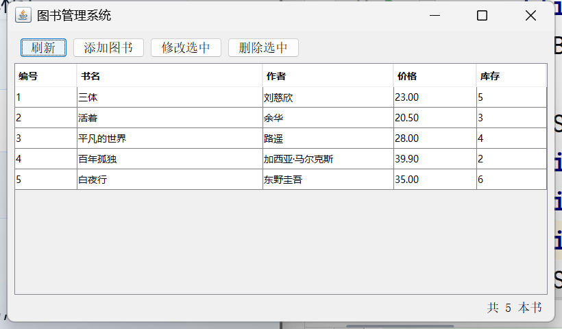

# 图书管理系统（Java Swing + MySQL）

一个用 Java 8 + Swing 界面 + JDBC + MySQL 8.4 写的桌面图书管理程序，支持图书的增、删、改、查。

## 功能

- 启动即从数据库加载图书列表，用表格展示
- **添加图书**：弹出对话框填写，带输入校验（书名必填、价格/库存必须是数字）
- **修改图书**：选一行点修改（或直接双击该行），原数据自动填入对话框
- **删除图书**：二次确认后删除
- 刷新列表、点击表头可按任意列排序

## 截图



## 技术栈

| 部分 | 技术 |
|---|---|
| 语言 | Java 8 |
| 界面 | Swing（JFrame / JTable / JDialog / JOptionPane） |
| 数据库访问 | JDBC + PreparedStatement（预编译语句，防 SQL 注入） |
| 数据库 | MySQL 8.4.9 |
| 驱动 | mysql-connector-j 8.4.0 |

## 项目结构

```
src/
├── MainFrame.java       主窗口：表格 + 工具栏按钮
├── BookDialog.java      添加 / 修改图书的对话框（含输入校验）
├── BookTableModel.java  表格模型：把 List<Book> 变成 JTable 能显示的数据
├── BookDao.java         数据访问层：增删改查
├── Book.java            实体类：一本书（对应 books 表一行）
├── DbUtil.java          数据库连接工具类
├── DbTest.java          连接测试（开发第 3 步的验证程序）
└── DaoTest.java         DAO 层测试（开发第 4 步的验证程序）
lib/                     JDBC 驱动 jar
sql/init.sql             建库建表脚本（含示例数据）
docs/screenshot.png      界面截图
```

## 运行方法

1. 安装 MySQL 8.4，执行 `sql/init.sql` 建库建表
2. 按需修改 `src/DbUtil.java` 里的数据库地址、账号、密码
3. 编译：

```bash
javac -encoding UTF-8 -cp "lib/mysql-connector-j-8.4.0.jar" -d out src/*.java
```

4. 运行：

```bash
java -Dfile.encoding=UTF-8 -cp "out;lib/mysql-connector-j-8.4.0.jar" MainFrame
```

## 开发过程

1. **搭环境**：引入 JDBC 驱动 → 建 books 表 → 写最小程序验证 Java 能连上 MySQL
2. **DAO 层**：Book 实体 + BookDao 增删改查 + 控制台测试全部通过
3. **界面**：先做只读表格窗口，确认能显示数据库数据
4. **完整 CRUD 界面**：加工具栏按钮和录入对话框，实现可视化增删改查

## 后续计划

- [ ] 搜索框（按书名 / 作者模糊查询）
- [ ] 分页显示
- [ ] 借阅记录表（读者、借出时间、归还时间）
- [ ] 导出 Excel

## 作者

罗传翔（青岛航空科技职业学院 · 计算机应用技术 · 2027 届）
GitHub: [@luochuanxiang](https://github.com/luochuanxiang)
